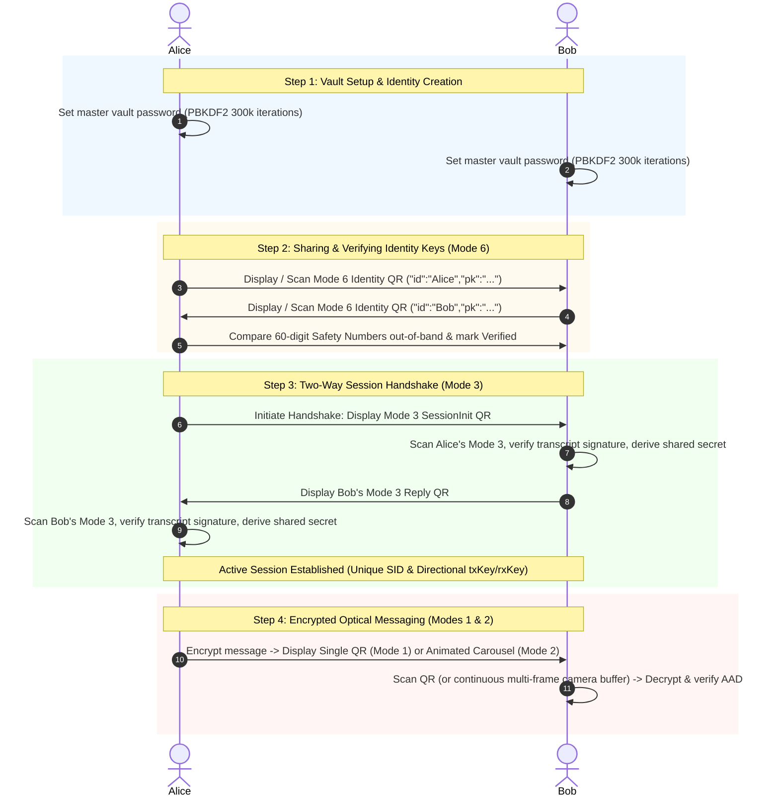

# Beluga Android

> **Zero-Permission, Air-Gapped Optical End-to-End Encrypted Messenger**

Beluga Android is a high-security, completely offline, air-gap-capable asynchronous messaging client. It transmits encrypted messages exclusively via optical QR codes and encrypted PNG image transfers—requiring **zero network permissions** (`android.permission.INTERNET` is neither requested nor used).

---

## Key Features

- **Hardened v2 Protocol**: Upgraded from `beluga-e2ee` v1 with complete mitigation of 22 identified architectural and cryptographic vulnerabilities.
- **Strictly Offline & Air-Gapped**: Zero network permissions in `AndroidManifest.xml`. No telemetry, no cloud servers, and no background network threads.
- **Universal Optical QR Scanner**: Powered by CameraX and 100% open-source ZXing running direct Y-plane luminance analysis. No Google Play Services or ML Kit dependencies.
- **Animated Multi-Chunk QR Carousel**: Automatically fragments payloads exceeding single-frame density thresholds into interactive multi-frame animated sequences with configurable cycle speed (100–1000 ms) and real-time chunk assembly progress.
- **Direct Encrypted QR PNG Sharing**: Share encrypted QR images securely via Android share sheets without leaking raw plaintext files.
- **Screen & Memory Protection**: Enforces `WindowManager.LayoutParams.FLAG_SECURE` to block OS screenshots, screen recording, and system recent-apps switcher previews.
- **Auto-Locking Cryptographic Vault**: AES-256-GCM encrypted database (`database.bin`) derived via PBKDF2-HMAC-SHA256 (300,000 iterations) with atomic write transactions (`.tmp` / `.bak` recovery) and automatic 2-minute background inactivity lock.
- **60-Digit Signal-Style Safety Numbers**: Out-of-band cryptographic identity verification displayed in 12 groups of 5 decimal digits derived via HKDF-SHA256 from P-384 public keys.
- **100% Free & Open Source**: Clean architecture built on Jetpack Compose, CameraX, ZXing, and BouncyCastle.

---

## Cryptographic Design Summary

Beluga operates on the NIST P-384 (secp384r1) elliptic curve offering 192 bits of symmetric security strength, coupled with AES-256-GCM authenticated encryption and HKDF-SHA256 key expansion.

| Primitive | Implementation / Parameters | Purpose |
| :--- | :--- | :--- |
| **Identity & Ephemeral Keys** | ECDSA / ECDH over NIST P-384 (`secp384r1`) | Long-term identity signatures and ephemeral Diffie-Hellman handshakes |
| **Authenticated Encryption** | AES-256-GCM (12-byte IV, 128-bit authentication tag) | Message payload encryption with context-binding AAD |
| **Additional Authenticated Data (AAD)** | `v2\|<sid>\|<seq>` | Prevents ciphertext splicing, session confusion, and sequence manipulation |
| **Session Ratcheting** | HKDF-SHA256 with distinct domain separation strings | Directional key derivation (`txKey != rxKey`) preventing reflection attacks |
| **Vault Encryption** | PBKDF2-HMAC-SHA256 (300,000 iterations) + AES-256-GCM | Encrypted local database (`database.bin`) with random 32-byte salt |
| **Data Encoding** | RFC 1924 Base85 | High-density alphanumeric QR encoding (25% more efficient than Base64) |
| **Compression** | Deflate / Inflate (RFC 1951) with strict 64 KB safety limit | Payload minimization before encryption (mitigates zip bomb DoS) |

---

## QR Wire Protocol Modes

Beluga encodes all optical exchanges as compact JSON objects with an explicit version flag (`v: 2`) and operational mode:

| Mode | Type | JSON Wire Format | Description |
| :---: | :--- | :--- | :--- |
| **6** | `SharePublicKey` | `{"v":2,"mode":6,"id":"<name>","pk":"<pk85>"}` | Long-term identity public key exchange (49-byte compressed P-384). |
| **3** | `SessionInit` | `{"v":2,"mode":3,"sid":"<shortId>","epk":"<epk85>","ts":<ts>,"sig":"<sig85>"}` | Two-way authenticated ephemeral session handshake with transcript signature. |
| **1** | `SingleChunk` | `{"v":2,"mode":1,"sid":"<sid85>","seq":<seq>,"iv":"<iv85>","ct":"<ct85>","tag":"<tag85>"}` | Single-frame encrypted message payload. |
| **2** | `MultiChunk` | `{"v":2,"mode":2,"sid":"<sid85>","seq":<seq>,"idx":<idx>,"tot":<tot>,"iv":"<iv85>","ct":"<ct85>","tag":"<tag85>"}` | Fragmented encrypted message slice with chunk index and total count for multi-frame carousel scanning. |

---

## Step-by-Step Walkthrough



### 1. Vault Setup
When launched for the first time, Beluga prompts for your display name and master vault password. Confirming the password initializes `database.bin` using PBKDF2-HMAC-SHA256 (300,000 iterations) and generates your long-term NIST P-384 identity key pair.

### 2. Sharing & Verifying Identity Keys
1. Navigate to **Share Identity** from the home screen to display your Mode 6 Identity QR code.
2. Tap **Scan** on the peer device to import the identity into your Contacts list.
3. Open the contact card and compare the **60-Digit Safety Number** (arranged in 12 groups of 5 digits). Tap **Verify Safety Number** to mark the contact trusted.

### 3. Establishing an Encrypted Session
1. In the contact details screen, tap **Start Session**.
2. Beluga initiates an ephemeral P-384 key pair, signs the handshake transcript `v2|HANDSHAKE|<ourPub>|<contactPub>|<ourEphPub>|<timestamp>`, and displays the Mode 3 QR code.
3. The peer scans this code; their device verifies your signature, computes the shared ECDH secret, signs their return ephemeral key, and displays a Mode 3 response QR.
4. Scan their reply to finalize the session. Both devices now share an identical 8-byte session ID (`sid`) and synchronized directional transmission (`txKey`) and reception (`rxKey`) keys.

### 4. Sending & Receiving Messages
- **Compose**: Select an active contact and type your message. Small payloads generate a static Mode 1 QR code.
- **Large Payloads**: Text exceeding the single-QR safe capacity (e.g. long text or code snippets) is compressed with Deflate, sliced into numbered chunks, and presented as an animated Mode 2 carousel.
- **Receive**: Tap the scanner icon and point your camera at the sender's screen. For multi-chunk carousels, keep the camera steady; Beluga buffers incoming chunks in any order and triggers automatic reassembly and decryption once all chunks arrive.

---

## Building and Verification

### Prerequisites
- **Android Studio Ladybug (2024.2+)** or later
- **JDK 17 or 21** (`temurin` recommended)
- **Android SDK Platform 35** (minSdk 26, targetSdk 35)

### Command Line Build

```bash
# Clone the repository
git clone https://github.com/jlyons49/beluga-android.git
cd beluga-android

# Run unit tests
./gradlew testDebugUnitTest

# Run static analysis and linting
./gradlew lintDebug

# Build Debug APK
./gradlew assembleDebug

# Output APK location:
# app/build/outputs/apk/debug/beluga-debug.apk
```

---

## Documentation

Detailed technical documentation is available in the [`docs/`](docs/) directory:

- [**System Architecture & Specifications**](docs/architecture.md): Detailed subsystem diagrams, package decomposition, exact QR JSON wire schemas, HKDF domain separation strings, and database schemas.
- [**Threat Model & Security Hardening**](docs/security-model.md): Comprehensive security analysis, adversary capabilities, cryptographic guarantees, and the complete resolution table for all 22 vulnerabilities in `beluga-e2ee` v1.
- [**Release Engineering & Signing Guide**](docs/releasing.md): Keystore generation, secret encoding, GitHub Actions CI/CD pipeline configuration, and cryptographic release checksum verification.

---

## License

Copyright (c) 2026. All source code in this repository is licensed under the [Apache License, Version 2.0](LICENSE).
