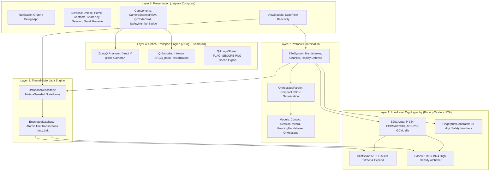
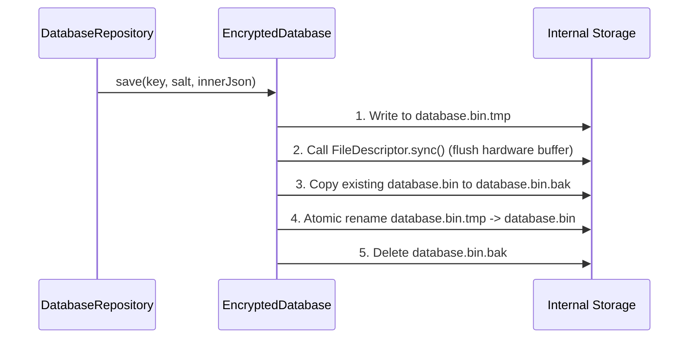

# Beluga Android: System Architecture & Technical Specification

## Overview

Beluga Android is an offline, air-gap-capable, zero-permission end-to-end encrypted messaging application. It operates without an Internet connection, communicating exclusively over optical channels (QR code generation, live CameraX scanning, and encrypted QR PNG export).

This document provides a comprehensive technical breakdown of the Beluga v2 architecture, protocol wire formats, cryptographic domain separation, and on-disk vault storage.

---

## Component Architecture

The application is structured into five distinct, loosely coupled layers with strict unidirectional dependencies:



### Package Layer Breakdown

1. **`com.beluga.e2ee.crypto`**:
   - `E2eCrypto`: NIST P-384 elliptic curve operations, ECDSA signature generation/verification (`SHA256withECDSA`), raw ECDH agreement, AES-256-GCM encryption/decryption with AAD, and bounded RFC 1950 zlib compression.
   - `HkdfSha256`: RFC 5869 HMAC-SHA-256 Key Derivation Function (extract & expand).
   - `Base85`: RFC 1924 Base85 codec providing a 5:4 byte ratio (approx. 25% denser than Base64).
   - `FingerprintGenerator`: Derives 60-digit Signal-style human-verifiable safety numbers and 10-character short key identifiers.

2. **`com.beluga.e2ee.storage`**:
   - `EncryptedDatabase`: Self-contained encrypted file engine (`database.bin`). Derives encryption keys using PBKDF2-HMAC-SHA256 (300,000 iterations) + HKDF-SHA256. Executes atomic disk transactions using `.tmp` staging, `fsync()`, and automatic `.bak` recovery.
   - `DatabaseRepository`: Mutex-protected singleton maintaining in-memory cache and emitting reactive read-only `StateFlow` primitives.

3. **`com.beluga.e2ee.protocol`**:
   - `E2eSystem`: Core cryptographic protocol coordinator. Manages Mode 6 identity exchanges, Mode 3 ephemeral authenticated session handshakes, Mode 1 single-frame encryption, and Mode 2 multi-frame chunk slicing, out-of-order buffering, and reassembly.
   - `QrMessageParser`: High-speed JSON serializer and parser for QR wire payloads.
   - `model.*`: Immutable data structures (`Contact`, `SessionRecord`, `PendingHandshake`, `PendingChunkState`, `QrMessage`).

4. **`com.beluga.e2ee.qr`**:
   - `ZxingQrAnalyzer`: CameraX `ImageAnalysis.Analyzer` extracting raw 8-bit luminance from the Y-plane (`ImageFormat.YUV_420_888`) directly into ZXing's `PlanarYUVLuminanceSource`, eliminating ML Kit dependencies and frame copies.
   - `QrEncoder`: High-efficiency QR rasterizer using flat `IntArray` allocations and batch `Bitmap.setPixels()` calls.
   - `QrImageSharer`: Secure direct export of rendered QR codes to app cache for system share sheets.

5. **`com.beluga.e2ee.ui`**:
   - Modern declarative UI built 100% in Jetpack Compose and Material 3, including interactive camera viewfinder overlays, animated multi-chunk QR carousels, and dark/light adaptive styling.

---

## Cryptographic Protocols & Wire Schemas

### 1. Mode 6: Long-Term Identity Key Sharing

Used to exchange long-term public keys out-of-band and establish contacts.

**JSON Schema:**
```json
{
  "v": 2,
  "mode": 6,
  "id": "Alice",
  "pk": "<49-byte compressed P-384 public key in RFC 1924 Base85>"
}
```

- `v` (Integer): Protocol version (must be `2`).
- `mode` (Integer): Operational mode (`6`).
- `id` (String, optional): Contact nickname or display identifier.
- `pk` (String): RFC 1924 Base85 string representing the 49-byte SEC 1 compressed P-384 public point (`0x02` or `0x03` prefix followed by 48-byte X coordinate).

**Validation Rules:**
- Base85 decode must produce exactly 49 bytes.
- First byte must be `0x02` or `0x03`.
- The point must lie on the secp384r1 curve and must not be the point at infinity.

---

### 2. Mode 3: Ephemeral Authenticated Session Handshake

Establishes a mutual cryptographic session between two contacts with forward secrecy, transcript authentication, and directional session keys.

**JSON Schema:**
```json
{
  "v": 2,
  "mode": 3,
  "sid": "<10-char Base85 short key ID of initiator>",
  "epk": "<49-byte compressed P-384 ephemeral public key in Base85>",
  "ts": 1792330000,
  "sig": "<DER-encoded ECDSA signature in Base85>"
}
```

- `v` (Integer): Must be `2`.
- `mode` (Integer): Must be `3`.
- `sid` (String): 10-character Base85 short key ID derived from the signer's identity public key.
- `epk` (String): Fresh ephemeral P-384 public key (49 bytes compressed Base85).
- `ts` (Long): Unix epoch timestamp in seconds. Must be within +/- 300 seconds of local time to prevent replay attacks.
- `sig` (String): Base85 encoded `SHA256withECDSA` signature over the binary transcript.

#### Binary Handshake Transcript Format
The signature covers the following canonical byte stream:
```
[ "BELUGA-v2-MODE3" (15 bytes) ]
[ 4-byte BE integer: length of signerId ]
[ signerId bytes (UTF-8) ]
[ signerIdentityPub (49 bytes) ]
[ recipientIdentityPub (49 bytes) ]
[ ephemeralPub (49 bytes) ]
[ 8-byte BE long: timestampSec ]
```

#### Session Key Derivation (HKDF-SHA256)
When both parties possess the ephemeral public keys ($E_A, E_B$) and identity public keys ($I_A, I_B$):
1. Compute raw ECDH shared secret: $Z = \text{ECDH}(e_A, E_B) = \text{ECDH}(e_B, E_A)$ (48 bytes).
2. Deterministically sort identity keys: $(PK_{\min}, PK_{\max}) = \text{sort}(I_A, I_B)$.
3. Deterministically sort ephemeral keys: $(E_{\min}, E_{\max}) = \text{sort}(E_A, E_B)$.
4. Construct HKDF inputs:
   - $\text{salt} = E_{\min} \parallel E_{\max}$ (98 bytes)
   - $\text{identityBinding} = PK_{\min} \parallel PK_{\max}$ (98 bytes)
5. Derive session identifier (8 bytes, encoded to 10 chars Base85):
   $$\text{SID} = \text{HKDF-Expand}(\text{HKDF-Extract}(\text{salt}, Z), \text{"BELUGA-v2-SID"} \parallel \text{identityBinding}, 8)$$
6. Derive directional root keys (32 bytes each):
   $$K_{\text{L2H}} = \text{HKDF-Expand}(\text{HKDF-Extract}(\text{salt}, Z), \text{"BELUGA-v2-KEY-L2H"} \parallel \text{identityBinding}, 32)$$
   $$K_{\text{H2L}} = \text{HKDF-Expand}(\text{HKDF-Extract}(\text{salt}, Z), \text{"BELUGA-v2-KEY-H2L"} \parallel \text{identityBinding}, 32)$$
7. Endpoint key assignment:
   - If our identity public key == $PK_{\min}$: $\text{txKey} = K_{\text{L2H}}$, $\text{rxKey} = K_{\text{H2L}}$.
   - If our identity public key == $PK_{\max}$: $\text{txKey} = K_{\text{H2L}}$, $\text{rxKey} = K_{\text{L2H}}$.

---

### 3. Mode 1: Single-Chunk Encrypted Message

For messages whose compressed, encrypted payload fits inside a standard density QR code (< 400 characters).

**JSON Schema:**
```json
{
  "v": 2,
  "mode": 1,
  "sid": "<8-byte session ID in Base85 (10 chars)>",
  "seq": 1,
  "iv": "<12-byte random IV in Base85>",
  "ct": "<Ciphertext bytes in Base85>",
  "tag": "<16-byte GCM tag in Base85>"
}
```

- `v` (Integer): `2`.
- `mode` (Integer): `1`.
- `sid` (String): Session ID matching active session with contact.
- `seq` (Long): Monotonic sequence number (starts at 1). Rejects if $\le \text{lastRxSeq}$.
- `iv` (String): 12-byte cryptographic random nonce in Base85.
- `ct` (String): AES-256-GCM ciphertext of the compressed payload.
- `tag` (String): 16-byte (128-bit) GCM authentication tag.

#### Per-Message Key & AAD Binding
Each message derives an ephemeral message key:
$$K_{\text{msg}} = \text{HKDF-Expand}(\text{HKDF-Extract}(\text{iv}, \text{txKey}), \text{"BELUGA-v2-MSG|" } \parallel \text{sid} \parallel \text{"|" } \parallel \text{seq}, 32)$$

**Associated Authenticated Data (AAD):**
```
v2|<sid>|<seq>
```
The GCM cipher verifies this exact AAD string during decryption before releasing any plaintext.

---

### 4. Mode 2: Multi-Chunk Encrypted Message

For payloads exceeding the single-frame density threshold. Messages are sliced into $N$ ordered fragments and displayed in an animated QR carousel.

**JSON Schema:**
```json
{
  "v": 2,
  "mode": 2,
  "sid": "<8-byte session ID in Base85>",
  "seq": 2,
  "idx": 0,
  "tot": 3,
  "iv": "<12-byte random IV in Base85>",
  "ct": "<Fragment ciphertext bytes in Base85>",
  "tag": "<16-byte GCM tag in Base85>"
}
```

- `idx` (Integer): 0-indexed fragment sequence index ($0 \le \text{idx} < \text{tot}$).
- `tot` (Integer): Total number of chunks in this message.
- Slicing occurs on the compressed plaintext stream; each chunk is independently encrypted with its own 12-byte IV and unique per-chunk AAD:
  $$\text{AAD}_{\text{chunk}} = \text{v2\|<sid>\|<seq>\|<idx>\|<tot>}$$

---

## On-Disk Encrypted Vault (`database.bin`)

Beluga Android stores all sensitive keys, contacts, sessions, and pending handshakes in a single self-contained encrypted file in internal private storage (`context.filesDir/database.bin`).

### Outer Envelope (On Disk)

The outer file is a plaintext JSON envelope containing metadata and encrypted payload:

```json
{
  "v": 2,
  "salt": "<32-byte cryptographically random salt in Base85>",
  "iv": "<12-byte random IV in Base85>",
  "tag": "<16-byte GCM tag in Base85>",
  "ct": "<AES-256-GCM encrypted inner JSON in Base85>"
}
```

- **Key Derivation**:
  $$\text{MasterKey} = \text{HKDF-Expand}(\text{PBKDF2-HMAC-SHA256}(\text{password}, \text{salt}, c=300000, \text{len}=256), \text{"BELUGA-DB-KEY"}, 32)$$
- **Vault AAD**:
  $$\text{AAD}_{\text{db}} = \text{"v2|beluga-db"}$$

### Inner Decrypted JSON Schema

Once authenticated and decrypted, the inner payload structure is:

```json
{
  "displayName": "Alice",
  "signingKey": "<Base85-encoded PKCS#8 private identity key>",
  "contacts": {
    "Bob": {
      "publicKey": "<Base85 compressed P-384 public key>",
      "addedAt": 1792330000000,
      "verified": true
    }
  },
  "sessions": {
    "Bob": {
      "sid": "k9xL2Pq...",
      "txKey": "<Base85 32-byte key>",
      "rxKey": "<Base85 32-byte key>",
      "txSeq": 5,
      "lastRxSeq": 4,
      "establishedAt": 1792330100000
    }
  },
  "pendingHandshakes": {
    "Bob": {
      "userId": "Bob",
      "ownEphemeralPriv": "<Base85 private key>",
      "ownEphemeralPub": "<Base85 public key>",
      "ownTimestampSec": 1792330100,
      "ownQrPayload": "{\"v\":2,\"mode\":3,...}",
      "initiatedAt": 1792330100000
    }
  }
}
```

### Crash-Resilient Atomic Transactions

Database writes use a double-buffering staging mechanism to prevent data corruption during ungraceful app termination or power loss:



If the application crashes during Step 3 or 4, the subsequent startup invokes `readAtomic()`, which automatically detects the broken/missing file and restores the validated `database.bin.bak`.
